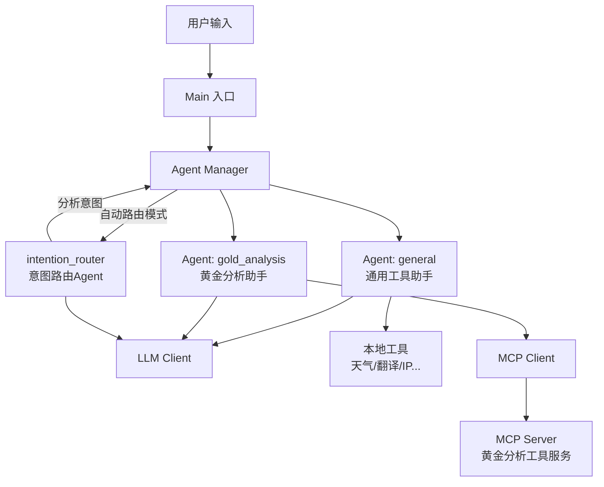
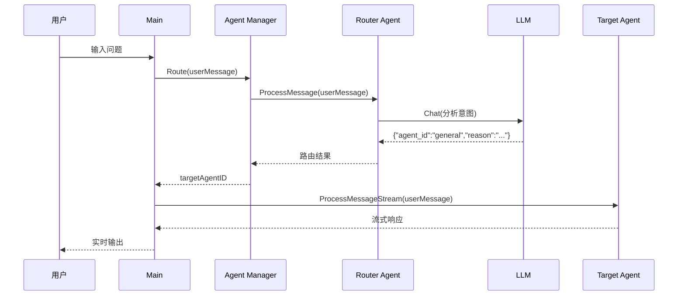
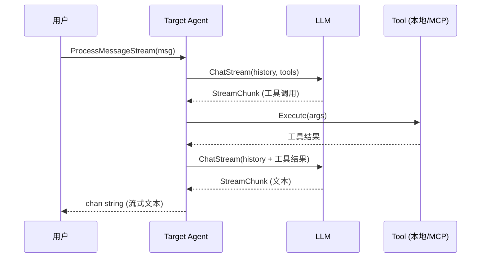

# Agent-Hwan

一个基于 Go 实现的多 Agent AI 系统，支持**意图自动路由**、流式对话、自动工具调用、MCP 协议集成、日志系统和灵活的 YAML 配置管理。

## ✨ 核心特性

- 🤖 **多Agent架构** — 启动时注册全部Agent，支持按需切换
- 🔀 **意图自动路由** — 内置路由Agent（intention_router），自动分析用户意图并分发到合适的专业Agent
- 🔧 **自动工具调用** — Agent 自动识别意图并调用外部工具完成任务
- 🌊 **流式响应** — 支持流式输出，实时展示 AI 回答，流式模式下同样支持工具调用
- 🔌 **MCP协议支持** — 通过 Model Context Protocol 动态发现和调用远程工具服务
- 📝 **日志系统** — 统一的日志管理（INFO/ERROR/WARNING → 文件）
- ⚙️ **YAML 配置** — 统一使用 `config.yaml` 管理所有配置项
- 🔒 **并发安全** — 使用互斥锁 + channel 机制保护对话历史的并发访问
- 💬 **对话管理** — 每个Agent拥有独立的对话历史和上下文维护

## 🤖 内置Agent

| # | Agent ID | 名称 | 类型 | 功能 |
|---|----------|------|------|------|
| 1 | `intention_router` | 意图路由助手 | 系统Agent | 自动分析用户意图，路由到合适的专业Agent |
| 2 | `general` | 通用工具助手 | 业务Agent | 天气、翻译、IP查询、二维码等通用服务 |
| 3 | `gold_analysis` | 黄金分析助手 | 业务Agent | 专业黄金市场分析、行情查询（MCP工具） |

## 📦 内置工具

### 通用工具（general Agent）

| # | 工具名 | 功能 | 依赖服务 |
|---|--------|------|----------|
| 1 | `qweather` ☁️ | 查询城市实时天气（温度、湿度、风力等） | 和风天气 API |
| 2 | `ipapi` 🌍 | 查询 IP/域名的地理位置与网络信息 | ipapi.com |
| 3 | `qrcode` 🔢 | 生成二维码（dataurl / ascii / file） | 本地生成 |
| 4 | `translate` 🔡 | 多语言文本翻译 | LibreTranslate |
| 5 | `textprocessor` ✏️ | 文本统计、格式转换、内容提取、文本生成 | 本地处理 |
| 6 | `shorturl` 🔗 | 长 URL 转短链接（TinyURL / is.gd / v.gd） | 第三方短链接服务 |

### MCP工具（gold_analysis Agent）

通过 MCP 协议从远程服务器动态发现，具体工具取决于 MCP 服务端提供的能力。

## 🏗️ 项目结构

```
agent-hwan/
├── cmd/
│   ├── config/
│   │   └── config.yaml                  # 统一配置文件（YAML）
│   └── server/
│       └── main.go                       # 程序入口（全部Agent注册与交互）
├── internal/
│   ├── agent/
│   │   ├── agent.go                      # Agent 核心（对话循环、工具调用、并发控制）
│   │   └── manager.go                    # Agent 管理器（注册、切换、意图路由）
│   ├── config/
│   │   └── config.go                     # 配置加载与验证
│   ├── llm/
│   │   ├── openai.go                     # OpenAI/DeepSeek API 客户端
│   │   ├── schema.go                     # API 响应结构定义
│   │   └── stream_scanner.go             # SSE 流式响应解析
│   ├── logger/
│   │   └── logger.go                     # 日志系统（INFO/ERROR/WARNING → 文件）
│   ├── prompt/
│   │   ├── prompt.go                     # 提示词加载与模板替换
│   │   ├── general_prompt.yaml           # 通用工具助手系统提示词
│   │   ├── gold_analysis_prompt.yaml     # 黄金分析助手系统提示词
│   │   ├── intention_router_prompt.yaml  # 意图路由Agent系统提示词
│   │   └── scene.go                      # 场景常量定义
│   └── tools/
│       ├── setup.go                      # 工具统一注册（支持通用/MCP分组）
│       ├── registry.go                   # 工具注册表（生成工具描述供 Prompt 使用）
│       ├── mcp/                          # MCP工具模块
│       │   ├── client.go                 # MCP客户端（JSON-RPC通信）
│       │   └── tool.go                   # MCP工具适配器（适配types.Tool接口）
│       ├── weather.go                    # 天气查询工具
│       ├── ip.go                         # IP 查询工具
│       ├── qrcode.go                     # 二维码生成工具
│       ├── translation.go                # 翻译工具
│       ├── textprocessor.go              # 文本处理工具
│       └── shorturl.go                   # 短链接生成工具
├── pkg/
│   ├── types/
│   │   └── types.go                      # 公共类型定义（Message, Tool, Config 等）
│   └── utils/
│       └── utils.go                      # 工具函数
├── logs/
│   └── agent.log                         # 运行日志输出
├── REFERENCE/                            # 参考文档
├── go.mod
├── go.sum
└── README.md
```

## 🚀 快速开始

### 1. 环境要求

- Go 1.24+
- 网络连接（访问 LLM API 和工具 API）
- （可选）MCP 工具服务端（黄金分析助手需要）

### 2. 安装依赖

```bash
git clone <repository-url>
cd agent-hwan
go mod tidy
```

### 3. 配置

编辑 `cmd/config/config.yaml`：

```yaml
# 日志配置
log:
  file_path: "../../logs/agent.log"

# Prompt 目录配置
prompt:
  dir: "../../internal/prompt"

# LLM 配置
llm:
  provider: "deepseek"
  api_key: "your-api-key"
  model: "deepseek-chat"
  base_url: "https://api.deepseek.com/v1"

# Agent 通用配置
agent:
  name: "智能助手"
  description: "一个能够使用工具的智能AI助手"
  max_tokens: 4096
  temperature: 0.7

# 多Agent配置列表（启动时全部注册）
agents:
  - id: "intention_router"
    name: "意图路由助手"
    description: "自动分析用户意图并路由到合适的专业Agent处理"
    prompt_scene: "intention_router_prompt"
    tool_group: "none"
  - id: "general"
    name: "通用工具助手"
    description: "提供天气查询、IP查询、翻译、二维码生成等通用工具服务"
    prompt_scene: "general_prompt"
    tool_group: "general"
  - id: "gold_analysis"
    name: "黄金分析助手"
    description: "提供专业的黄金市场分析、行情查询和投资参考服务"
    prompt_scene: "gold_analysis_prompt"
    tool_group: "mcp_gold"

# 工具配置
tools:
  weather:
    api_key: "your-qweather-api-key"
    base_url: "https://your-qweather-endpoint"
  ip:
    access_key: "your-ipapi-access-key"
  translate:
    base_url: "http://127.0.0.1:5000"
    api_key: ""

# MCP工具配置
mcp:
  servers:
    - name: "gold-analysis-server"
      base_url: "http://127.0.0.1:8080/mcp"
      api_key: ""
      timeout: 30
```

### 4. 运行

```bash
cd cmd/server
go run main.go
```

### 5. 交互示例

```
========== 🤖 AI Agent 助手（多Agent模式） ==========

  ✅ Agent [intention_router] (意图路由助手) 创建成功 [系统路由]
  ✅ Agent [general] (通用工具助手) 创建成功
  ✅ Agent [gold_analysis] (黄金分析助手) 创建成功

🤖 可用Agent列表
--------------------------------------------------
▶ 1. ✅ [general] 通用工具助手
      提供天气查询、IP查询、翻译、二维码生成等通用工具服务
  2. ✅ [gold_analysis] 黄金分析助手
      提供专业的黄金市场分析、行情查询和投资参考服务
--------------------------------------------------

👤 [auto] > 北京的天气怎么样？
🔀 [自动路由] → 通用工具助手 (涉及天气查询)
🤖 助手: ...（流式输出天气信息）

👤 [auto] > 今日黄金行情如何？
🔀 [自动路由] → 黄金分析助手 (涉及黄金行情分析)
🤖 助手: ...（流式输出黄金分析结果）

👤 [auto] > switch general
✅ 已切换到: 通用工具助手 (general)，自动路由已关闭

👤 [general] > auto
✅ 已开启自动路由模式，系统将自动判断并分配最合适的Agent
```

## 🔍 架构设计

### 多Agent + 意图路由架构



### 意图路由流程



### 核心对话流程



### 并发安全机制

- **`sync.Mutex`**：保护 `history` 切片的并发读写
- **`sync.RWMutex`**：Agent Manager 使用读写锁支持并发读取
- **`chan struct{}` (streamDone)**：确保流式 goroutine 完成 history 写入后，下一次请求才能开始
- **`waitStreamDone()`**：在 `ProcessMessage`、`ProcessMessageStream`、`GetConversationHistory`、`ClearHistory` 入口处等待上一次流式任务完成

### 日志系统

- 交互式输出（提示、AI 回答）→ **终端 stdout**
- 运行日志（初始化、工具调用、错误）→ **日志文件** (`logs/agent.log`)
- 日志级别：`INFO`、`ERROR`、`WARNING`
- 基于 Go 标准库 `log` 实现，轻量无第三方依赖

## 🛠️ 开发指南

### 添加新Agent

1. 在 `internal/prompt/` 下创建新的 prompt YAML 文件：

```yaml
scene: "my_agent_prompt"
name: "我的Agent"
system_prompt: |
  你是一个专业的...
  {{TOOLS_SECTION}}
```

2. 在 `internal/prompt/scene.go` 中添加场景常量：

```go
const MY_AGENT_PROMPT = "my_agent_prompt"
```

3. 在 `config.yaml` 的 `agents` 列表中添加配置：

```yaml
agents:
  - id: "my_agent"
    name: "我的Agent"
    description: "Agent描述"
    prompt_scene: "my_agent_prompt"
    tool_group: "general"  # 或自定义工具组
```

4. 如需自定义工具组，在 `main.go` 的 `initAllAgents` 中添加对应的工具注册逻辑。

5. 更新 `intention_router_prompt.yaml` 中的路由规则，添加新Agent的路由条件。

### 添加新的本地工具

1. 在 `internal/tools/` 下创建新文件，实现 `types.Tool` 接口：

```go
type MyTool struct { /* ... */ }

func (t *MyTool) Name() string                { return "mytool" }
func (t *MyTool) Description() string          { return "我的工具描述" }
func (t *MyTool) Parameters() map[string]interface{} { /* JSON Schema */ }
func (t *MyTool) Execute(ctx context.Context, args map[string]interface{}) (string, error) {
    // 实现工具逻辑
}
```

2. 在 `internal/tools/setup.go` 的 `SetupGeneralTools` 中注册。

3. 在 `internal/tools/registry.go` 中添加工具描述信息。

### 接入MCP工具服务

1. 实现一个 MCP 服务端（遵循 JSON-RPC 2.0 协议），提供：
   - `tools/list` — 返回可用工具列表
   - `tools/call` — 执行工具调用

2. 在 `config.yaml` 的 `mcp.servers` 中添加服务配置：

```yaml
mcp:
  servers:
    - name: "my-mcp-server"
      base_url: "http://127.0.0.1:9090/mcp"
      api_key: ""
      timeout: 30
```

3. 在 `agents` 配置中指定 `tool_group: "mcp_gold"`（或自定义工具组）。

### 切换 LLM 提供商

修改 `config.yaml` 中的 `llm` 配置即可，支持任何兼容 OpenAI API 格式的服务：

```yaml
llm:
  provider: "openai"
  api_key: "sk-xxx"
  model: "gpt-4"
  base_url: "https://api.openai.com/v1"
```

## 📋 依赖

| 依赖 | 用途 |
|------|------|
| `github.com/chzyer/readline` | 终端交互（支持历史记录、行编辑） |
| `github.com/skip2/go-qrcode` | 二维码生成 |
| `golang.org/x/text` | 文本处理 |
| `gopkg.in/yaml.v2` | YAML 配置解析 |

## ⚠️ 注意事项

1. **API 密钥安全**：`config.yaml` 中包含敏感信息，请勿提交到公开仓库（已在 `.gitignore` 中排除）
2. **网络依赖**：天气、翻译、短链接等工具需要网络访问对应的 API 服务
3. **翻译服务**：默认使用本地 LibreTranslate 实例（`http://127.0.0.1:5000`），需自行部署或替换为公共实例
4. **MCP服务**：黄金分析助手依赖 MCP 工具服务端，如服务未启动，Agent 仍可创建但无可用工具
5. **日志路径**：默认日志输出到 `logs/agent.log`，路径相对于运行目录
6. **Agent独立性**：每个Agent拥有独立的对话历史和工具集，切换Agent不会丢失之前的对话
7. **路由Agent**：`intention_router` 是系统Agent，不对外展示，不可手动切换到该Agent

## 📄 许可证

MIT License