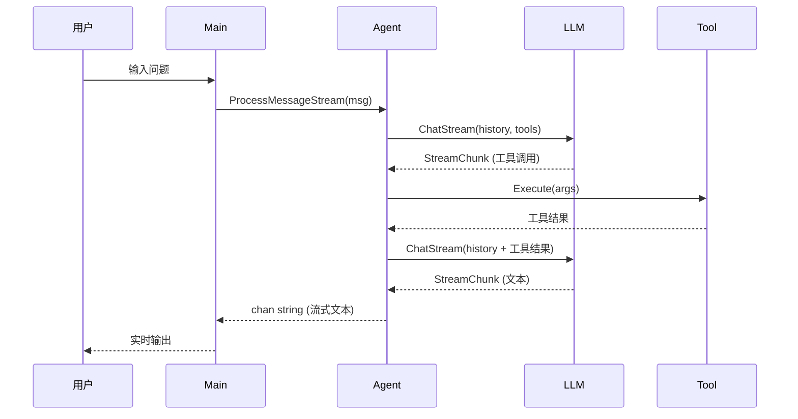

# Agent-Hwan

一个基于 Go 实现的 AI Agent 项目，支持流式对话、自动工具调用、日志系统和灵活的 YAML 配置管理。

## ✨ 核心特性

- 🤖 **智能对话** — 基于 OpenAI/DeepSeek 等大语言模型进行自然语言交互
- 🔧 **自动工具调用** — Agent 自动识别意图并调用外部工具完成任务
- 🌊 **流式响应** — 支持流式输出，实时展示 AI 回答，流式模式下同样支持工具调用
- 📝 **日志系统** — 统一的日志管理（INFO/ERROR/WARNING → 文件）
- ⚙️ **YAML 配置** — 统一使用 `config.yaml` 管理所有配置项
- 🔒 **并发安全** — 使用互斥锁 + channel 机制保护对话历史的并发访问
- 💬 **对话管理** — 完整的对话历史管理和上下文维护

## 📦 内置工具

| # | 工具名 | 功能 | 依赖服务 |
|---|--------|------|----------|
| 1 | `qweather` ☁️ | 查询城市实时天气（温度、湿度、风力等） | 和风天气 API |
| 2 | `ipapi` 🌍 | 查询 IP/域名的地理位置与网络信息 | ipapi.com |
| 3 | `qrcode` 🔢 | 生成二维码（dataurl / ascii / file） | 本地生成 |
| 4 | `translate` 🔡 | 多语言文本翻译 | LibreTranslate |
| 5 | `textprocessor` ✏️ | 文本统计、格式转换、内容提取、文本生成 | 本地处理 |
| 6 | `shorturl` 🔗 | 长 URL 转短链接（TinyURL / is.gd / v.gd） | 第三方短链接服务 |

## 🏗️ 项目结构

```
agent-hwan/
├── cmd/
│   ├── config/
│   │   └── config.yaml              # 统一配置文件（YAML）
│   └── server/
│       └── main.go                   # 程序入口
├── internal/
│   ├── agent/
│   │   └── agent.go                  # Agent 核心（对话循环、工具调用、并发控制）
│   ├── config/
│   │   └── config.go                 # 配置加载与验证
│   ├── llm/
│   │   ├── openai.go                 # OpenAI/DeepSeek API 客户端
│   │   └── stream_scanner.go         # SSE 流式响应解析
│   ├── logger/
│   │   └── logger.go                 # 日志系统（INFO/ERROR/WARNING → 文件）
│   ├── prompt/
│   │   ├── prompt.go                 # 提示词加载与模板替换
│   │   ├── prompt.yaml               # 系统提示词配置
│   │   └── scene.go                  # 场景定义
│   └── tools/
│       ├── setup.go                  # 工具统一注册
│       ├── registry.go               # 工具注册表（生成工具描述供 Prompt 使用）
│       ├── weather.go                # 天气查询工具
│       ├── ip.go                     # IP 查询工具
│       ├── qrcode.go                 # 二维码生成工具
│       ├── translation.go            # 翻译工具
│       ├── textprocessor.go          # 文本处理工具
│       └── shorturl.go               # 短链接生成工具
├── pkg/
│   ├── types/
│   │   └── types.go                  # 公共类型定义（Message, Tool, Config 等）
│   └── utils/
│       └── utils.go                  # 工具函数
├── logs/
│   └── agent.log                     # 运行日志输出
├── REFERENCE/                        # 参考文档
│   ├── AI agent 系统架构.md
│   └── 关于代码的一些问题.md
├── go.mod
├── go.sum
└── README.md
```

## 🚀 快速开始

### 1. 环境要求

- Go 1.24+
- 网络连接（访问 LLM API 和工具 API）

### 2. 安装依赖

```bash
git clone <repository-url>
cd agent-hwan
go mod tidy
```

### 3. 配置

编辑 `cmd/config/config.yaml`：

```yaml
# 日志配置
log:
  file_path: "../../logs/agent.log"

# Prompt 目录配置
prompt:
  dir: "../../internal/prompt"

# LLM 配置
llm:
  provider: "deepseek"
  api_key: "your-api-key"
  model: "deepseek-chat"
  base_url: "https://api.deepseek.com/v1"

# Agent 配置
agent:
  name: "智能助手"
  description: "一个能够使用工具的智能AI助手"
  max_tokens: 4096
  temperature: 0.7

# 工具配置
tools:
  weather:
    api_key: "your-qweather-api-key"
    base_url: "https://your-qweather-endpoint"
  ip:
    access_key: "your-ipapi-access-key"
  translate:
    base_url: "http://127.0.0.1:5000"
    api_key: ""
```

也支持通过环境变量配置（当配置文件不存在时自动回退）：

```bash
export LLM_API_KEY="your-api-key"
export LLM_MODEL="deepseek-chat"
export LLM_BASE_URL="https://api.deepseek.com/v1"
export WEATHER_API_KEY="your-qweather-key"
export WEATHER_BASE_URL="https://your-qweather-endpoint"
# ... 更多环境变量见 internal/config/config.go
```

### 4. 运行

```bash
cd cmd/server
go run main.go
```

### 5. 交互示例

```
========== 🤖 AI Agent 助手 ==========

🎉 AI Agent已准备就绪！

💡 你可以尝试以下问题：
   • 北京的天气怎么样？
   • 查询 8.8.8.8 的IP信息
   • 生成一个内容为 https://example.com 的二维码
   • 请把"今天天气不错"翻译为英文
   • 统计这段文字的字符数："Hello World"
   • 帮我缩短这个链接：https://github.com/example/repo

🔧 可用命令：
   • 'help'    - 显示帮助信息
   • 'history' - 查看对话历史
   • 'clear'   - 清空对话历史
   • 'tools'   - 查看可用工具
   • 'quit'    - 退出程序

👤 用户: 将"我叫李明，很高兴遇见你"翻译为日语
🤖 助手: ...（流式输出翻译结果）
```

## 🔍 架构设计

### 核心流程



### 并发安全机制

- **`sync.Mutex`**：保护 `history` 切片的并发读写
- **`chan struct{}` (streamDone)**：确保流式 goroutine 完成 history 写入后，下一次请求才能开始
- **`waitStreamDone()`**：在 `ProcessMessage`、`ProcessMessageStream`、`GetConversationHistory`、`ClearHistory` 入口处等待上一次流式任务完成

### 日志系统

- 交互式输出（提示、AI 回答）→ **终端 stdout**
- 运行日志（初始化、工具调用、错误）→ **日志文件** (`logs/agent.log`)
- 日志级别：`INFO`、`ERROR`、`WARNING`
- 基于 Go 标准库 `log` 实现，轻量无第三方依赖

## 🛠️ 开发指南

### 添加新工具

1. 在 `internal/tools/` 下创建新文件，实现 `types.Tool` 接口：

```go
type MyTool struct { /* ... */ }

func (t *MyTool) Name() string                { return "mytool" }
func (t *MyTool) Description() string          { return "我的工具描述" }
func (t *MyTool) Parameters() map[string]interface{} { /* JSON Schema */ }
func (t *MyTool) Execute(ctx context.Context, args map[string]interface{}) (string, error) {
    // 实现工具逻辑
}
```

2. 在 `internal/tools/setup.go` 中注册：

```go
myTool := NewMyTool()
aiAgent.AddTool(myTool)
```

3. 在 `internal/tools/registry.go` 中添加工具描述信息（供系统提示词使用）。

### 切换 LLM 提供商

修改 `config.yaml` 中的 `llm` 配置即可，支持任何兼容 OpenAI API 格式的服务：

```yaml
llm:
  provider: "openai"
  api_key: "sk-xxx"
  model: "gpt-4"
  base_url: "https://api.openai.com/v1"
```

## 📋 依赖

| 依赖 | 用途 |
|------|------|
| `github.com/chzyer/readline` | 终端交互（支持历史记录、行编辑） |
| `github.com/skip2/go-qrcode` | 二维码生成 |
| `golang.org/x/text` | 文本处理 |
| `gopkg.in/yaml.v2` | YAML 配置解析 |

## ⚠️ 注意事项

1. **API 密钥安全**：`config.yaml` 中包含敏感信息，请勿提交到公开仓库（已在 `.gitignore` 中排除）
2. **网络依赖**：天气、翻译、短链接等工具需要网络访问对应的 API 服务
3. **翻译服务**：默认使用本地 LibreTranslate 实例（`http://127.0.0.1:5000`），需自行部署或替换为公共实例
4. **日志路径**：默认日志输出到 `logs/agent.log`，路径相对于运行目录

## 📄 许可证

MIT License